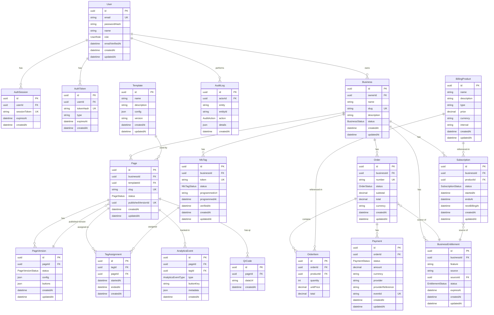

# Diagrama Entidad-Relación — Taply

## Diagrama Mermaid

## Relaciones clave

| Relación | Cardinalidad | Descripción |
|---|---|---|
| User → Business | 1:N | Un usuario puede tener múltiples negocios. |
| Business → Page | 1:N | Un negocio puede tener múltiples páginas. |
| Page → PageVersion | 1:N | Una página tiene múltiples versiones; una es la publicada. |
| Page ↔ PageVersion | N:1 (published) | La página referencia una versión publicada específica. |
| NfcTag → TagAssignment | 1:N | Una etiqueta puede tener múltiples asignaciones a lo largo del tiempo. |
| Page → TagAssignment | 1:N | Una página puede ser asignada a múltiples etiquetas. |
| Order → OrderItem | 1:N | Una orden contiene múltiples items. |
| Order → Payment | 1:N | Una orden puede tener múltiples pagos. |
| Business → BusinessEntitlement | 1:N | Un negocio tiene múltiples derechos de uso. |
| Order/Subscription → BusinessEntitlement | 1:N | Una orden o suscripción genera derechos de uso. |

## Restricciones especiales

1. **Una sola versión publicada por página**: `publishedVersionId` es único en Page.
2. **Una sola asignación activa por etiqueta**: Índice parcial único sobre TagAssignment donde `endedAt IS NULL`.
3. **Importes no negativos**: CHECK constraints en Payment.amount, Order.total, BillingProduct.price.
4. **Cantidades positivas**: CHECK constraint en OrderItem.quantity > 0.
5. **Eventos de pago únicos**: `eventId` es único en Payment para evitar duplicados.
